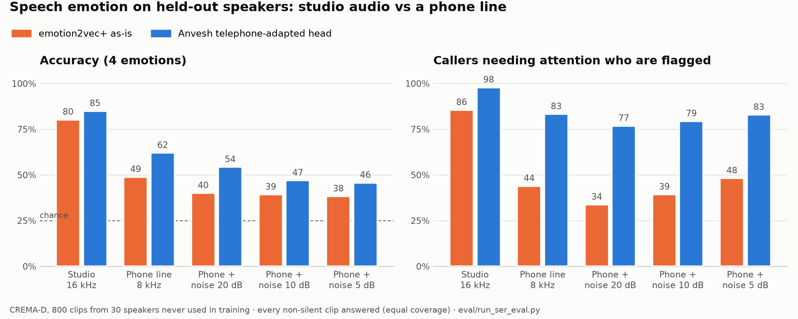

# Evaluation

This page explains **what we tested, how we tested it, what we found, and where the results stop applying**.
Every number here comes from a script in this repository that anyone can re-run. We do not report numbers we have
not measured.

## Summary

| What is tested | Data | How | Result |
|---|---|---|---|
| Software correctness | 115 unit, API and security tests | `pytest -q` (runs in CI on every push) | **115 / 115 pass** |
| Hinglish field extraction | 20 scripted phrases, 38 field checks | `python eval/run_eval.py` (runs in CI) | **38 / 38 (100%)** on the development set |
| Speech emotion through a phone line | CREMA-D, 800 clips from 30 held-out speakers | `python eval/run_ser_eval.py --holdout` | accuracy **49.0% → 62.1%**, attention recall **0.44 → 0.83** (raw model → Anvesh) |
| Speech emotion, studio audio | same | same | accuracy **85.1%**, attention recall **0.98** |
| Calibration and fairness | same | same | calibration error ≤ 0.07 on every condition; largest group gap 4.2 pts |
| Safety behaviour (role gating, abstention, coercion alerts) | Unit tests with controlled inputs | `pytest -q` | **pass** |

---

## 1. Software tests

`pytest -q` runs 115 tests with no speech models installed. They cover:

- **Speech-emotion logic:** smoothing, the caller-baseline arousal model, mapping to fear, anger, distress and
  nervousness, abstention on silence and low confidence, and that a victim is never shown as "happy".
- **Distress track:** role gating (off for suspects) and abstention on poor audio or unvalidated languages.
- **Hinglish handling:** number words and identifiers, evidence span mapping, demanded vs lost amounts, and
  telling UTR, phone and account numbers apart.
- **Triage and alerts:** sustained distress raises priority by at most one level and never for suspects; emotion never
  changes the financial score; coercion and crisis phrases are detected.
- **Telephone head and latency:** the head's output is a valid calibrated distribution, broken embeddings fall back
  to the raw model, and live latency is summarised correctly.
- **Investigation tools:** Ring Linker, synthetic-voice acoustic cues, and that officer corrections stick.
- **Security:** every route needs a session, role permissions, CSRF, encryption at rest, and audit-chain tamper
  detection.
- **Failure handling:** the app fails honestly when no ASR model is installed (nothing is simulated).

## 2. Field extraction from Hinglish speech

**Method.** `backend/eval/cases.jsonl` has 20 phrases written the way callers speak, for example:

- *"maine dedh lakh rupaye bheje ramesh at the rate okaxis pe"* → ₹1,50,000 and `ramesh@okaxis`
- *"mere saadhe paanch hazaar kat gaye aadha ghanta pehle"* → ₹5,500, 30 minutes ago

Each phrase lists the fields we expect. The script runs the normaliser and extractor and compares each field
exactly: amount, incident time, UPI ID, phone, account, IFSC, UTR, bank, payment app and claimed agency
(38 checks in total).

**Result.** 38 / 38 correct.

**What this means.** The spoken forms we designed for are handled. This is a **development set** written alongside
the code, so it is not an estimate of accuracy on real calls or on speech-to-text output, where transcription errors
come first.

## 3. Speech emotion recognition

### Headline

Helpline calls are **telephone audio**. We measured the off-the-shelf emotion model (emotion2vec+) on held-out speakers
and found it loses much of its accuracy through a phone line, and stays over-confident while it is wrong. Anvesh
therefore uses a **telephone-adapted head**: a small calibrated classifier on emotion2vec+'s own embedding, trained on
clean, telephone and noisy-telephone speech from **other** speakers. It runs on the same forward pass (under 1 ms extra)
and stays fully offline.



Held-out CREMA-D speakers, both systems answering every non-silent clip (**equal coverage**, so neither can look better
by abstaining more):

| Condition | Accuracy raw → Anvesh | Attention recall raw → Anvesh | False alarms on neutral raw → Anvesh | Calibration error raw → Anvesh |
|---|---|---|---|---|
| Studio 16 kHz | 80.3% → **85.1%** | 0.86 → **0.98** | 1.1% → 12.6% | 0.16 → **0.07** |
| Phone line (8 kHz, G.711) | 49.0% → **62.1%** | 0.44 → **0.83** | 2.6% → 25.1% | 0.44 → **0.02** |
| Phone + noise, 20 dB | 40.1% → **54.4%** | 0.34 → **0.77** | 4.7% → 33.7% | 0.51 → **0.02** |
| Phone + noise, 10 dB | 39.4% → **47.1%** | 0.39 → **0.79** | 16.7% → 50.6% | 0.52 → **0.05** |
| Phone + noise, 5 dB | 38.4% → **45.8%** | 0.48 → **0.83** | 34.9% → 58.7% | 0.53 → **0.04** |

*Attention recall* is the share of fear / anger / sadness clips that are flagged, the decision that matters for
prioritising a call. *False alarms* is the share of neutral clips flagged. Chance accuracy is 25%.

**What this shows.** On a phone line the raw model calls most distressed speech *neutral*: it flags only 44% of
callers who need attention. The adapted head flags 83%, is right more often, and its confidence can be trusted
(calibration error 0.02 vs 0.44). The cost is more false alarms on calm speech, especially with heavy noise. That is
why emotion can move a call by **at most one priority level**, only when distress is **sustained**, never for suspect
recordings, and always with its reason shown to the officer (see `anvesh/triage.py`).

### What is evaluated

Every number comes from `backend/eval/run_ser_eval.py`, using **the same decision rules as the live call**:
silent or mostly unvoiced audio abstains; a top probability below 0.45 is shown as *uncertain*; a victim is never read
as "happy" (that mass is read as nervous arousal). Clips are trimmed of leading and trailing silence first, as the
live voice-activity cut does.

1. **Robustness:** each clip is scored clean (16 kHz), through a simulated telephone channel (8 kHz, 300–3400 Hz band,
   G.711 µ-law), and with pink noise at 20, 10 and 5 dB SNR on top (`backend/eval/channel.py`).
2. **Calibration:** expected calibration error, and a sweep of the abstention threshold.
3. **Fairness:** accuracy and false alarms per speaker sex, age band and race.
4. **The live indicators:** ROC-AUC of the fear, anger and distress scores themselves.
5. **Model time** per 3-second window on CPU.

### Data and split

| Source | What it is | Use |
|---|---|---|
| **CREMA-D** (ODbL) | 7,442 acted English clips from 91 speakers of varied age, sex and race | 4 classes used (neutral, anger, fear, sadness; 4,900 clips) |
| Own role-play / public clips | Hindi, Hinglish and English victim-call role-play on a phone mic | supported via `--manifest`; see limitations |

The split is **by speaker**, so no voice is seen in both training and testing:

- **Test:** speakers whose ID is divisible by 3 (30 speakers). Used only here: 800 clips, balanced, 200 per class.
- **Validation:** other speakers with ID mod 9 equal to 1 or 2 (20 speakers). Used to choose regularisation and the
  calibration temperature.
- **Train:** the remaining 41 speakers. 3,148 clips, each played through a random condition (25% clean, 35% phone, 40%
  phone with noise).

### Reproduce

```bash
cd backend
python eval/get_eval_audio.py --crema-all                       # CREMA-D clips + speaker demographics (~500 MB)
python eval/train_ser_head.py --crema-d eval/audio/crema-d      # optional: rebuilds anvesh/data/models/ser_head_telephone.json
python eval/run_ser_eval.py --crema-d eval/audio/crema-d --holdout --limit 800
python eval/run_ser_eval.py --from-cache                        # re-derive every table from the saved predictions
```

Full output: [`backend/eval/results/ser_results.md`](backend/eval/results/ser_results.md). The per-clip model outputs
are saved in `backend/eval/results/predictions_*.csv` (no audio), so every number can be re-derived without the model.

### Live setting (what the officer sees)

With the live abstention threshold, the head answers fewer clips and is right more often when it does:

| Condition | Answered | Accuracy (answered) | Attention precision / recall | False alarms on neutral |
|---|---|---|---|---|
| Studio 16 kHz | 78.5% | 87.9% | 0.97 / 0.98 | 8.0% |
| Phone line (8 kHz, G.711) | 62.9% | 70.6% | 0.94 / 0.86 | 15.0% |
| Phone + noise, 20 dB | 53.9% | 62.2% | 0.91 / 0.79 | 22.0% |
| Phone + noise, 10 dB | 41.2% | 58.2% | 0.88 / 0.81 | 33.3% |
| Phone + noise, 5 dB | 29.0% | 57.8% | 0.87 / 0.88 | 45.1% |

Below 0.45 the officer sees *uncertain* instead of a guess. The threshold trades coverage for accuracy (phone line):

| Abstain below p | Answered | Accuracy (answered) | Attention recall |
|---|---|---|---|
| 0.00 | 85.5% | 62.1% | 0.83 |
| 0.35 | 80.0% | 64.4% | 0.84 |
| 0.45 (live) | 62.9% | 70.6% | 0.86 |
| 0.60 | 38.1% | 81.3% | 0.91 |
| 0.80 | 19.4% | 90.3% | 0.99 |

### Calibration

When the head says it is 80–90% sure on studio audio, it is right 97% of the time. On every telephone condition its
calibration error stays at or below 0.05, compared with 0.44–0.53 for the raw model. This is what makes the
abstention threshold meaningful: the raw model reports about 99% confidence even when it is wrong on a phone line.

### Fairness across speakers (studio audio, held-out speakers)

| Group | Speakers | Clips | Accuracy | Attention recall | False alarms on neutral |
|---|---|---|---|---|---|
| sex: female | 9 | 235 | 90.9% | 1.00 | 0.0% |
| sex: male | 21 | 565 | 86.7% | 0.98 | 11.5% |
| age: 20-29 | 10 | 267 | 86.5% | 0.98 | 11.1% |
| age: 30-49 | 16 | 424 | 88.9% | 0.99 | 8.1% |
| age: 50+ | 4 | 109 | 87.8% | 1.00 | 0.0% |
| race: African American | 10 | 265 | 88.4% | 1.00 | 9.8% |
| race: Caucasian | 19 | 515 | 87.1% | 0.98 | 7.5% |

Largest accuracy gap between groups with at least 3 speakers: sex 4.2 pts, age 2.3 pts,
race 1.3 pts. The male group has more false alarms on neutral speech (raised male voices are read
as anger more often). Only 30 speakers are in the test set and CREMA-D has no Indian speakers, so these gaps are a
first check, not a guarantee.

### The live indicators

ROC-AUC of each indicator as a score (0.5 = chance, 1.0 = perfect). This covers the model part. The part that compares
the caller with their own voice earlier in the call needs a whole call, so it is covered by unit tests.

| Indicator | Studio | Phone | +20 dB | +10 dB | +5 dB |
|---|---|---|---|---|---|
| Fear (fear vs others) | 0.95 | 0.81 | 0.76 | 0.73 | 0.72 |
| Anger (anger vs others) | 0.99 | 0.91 | 0.84 | 0.83 | 0.82 |
| Distress (fear or sadness vs neutral) | 0.96 | 0.78 | 0.73 | 0.69 | 0.68 |
| Any of the three vs neutral | 0.98 | 0.86 | 0.79 | 0.72 | 0.72 |

**Nervousness** has no label in any public dataset we could use, so it is **not validated** by these numbers. It is
derived from the fear score plus a rise in loudness, pitch and pace against the caller's own baseline. Treat it as the
least certain of the four signals.

### How to read the results

- CREMA-D is acted English. Results on real Hindi or Hinglish calls will differ (see limitations).
- The telephone channel is simulated. Real networks add codec artefacts (AMR, VoIP packet loss) that are not modelled.
- Fear and sadness are often confused. For triage this matters less, because both raise the *distress* signal.

## 4. Live performance

| Metric | Result | How |
|---|---|---|
| Emotion model per 3 s window (CPU, 2 cores) | median **275 ms**, p95 413 ms | `run_ser_eval.py`, section 6 |
| Telephone head | < 1 ms | one 4 × 768 matrix product |
| Emotion update interval | every 1.5 s of audio | `live_ser.HOP_S` |
| Live latency on your machine | median and p95, rolling | shown in the live call bar; `/api/health` → `live_latency` |

The live view shows two numbers during a call: *voice signal N ms* (last audio sample in → emotion reading out) and
*transcript N s after speech* (end of a spoken chunk → transcript and case file on screen).

---

## Limitations

1. **No public Indian-language emotional call dataset exists.** Our Hindi and Hinglish evaluation relies on a small
   set of role-play recordings and public clips, so per-language results are indicative only.
2. **Acted vs real emotion.** CREMA-D and role-play are acted; real distress can sound different (quieter, flatter,
   or masked by politeness).
3. **Telephone audio.** Even with the telephone-adapted head, accuracy on a noisy phone line (10 dB SNR or worse)
   is below 50% at full coverage, and false alarms on calm speech rise (34–59%). The system abstains more on such
   audio, emotion can move priority by one level at most, and only sustained distress counts. The phone channel in
   the evaluation is simulated (G.711); real networks add other codecs and packet loss.
4. **Model bias.** emotion2vec+ was trained mostly on Chinese and English speech, and the telephone head on English
   CREMA-D speech. The fairness table covers sex, age and race within CREMA-D, but there are no Indian speakers in it. Accents, age, gender and
   speaking style can shift its output. We report only languages we actually tested
   (`ANVESH_VALIDATED_LANGS=en,hi`); the distress track abstains for others.
5. **Emotion is not intent.** A fearful voice does not prove someone is a victim, and a calm voice does not prove
   someone is lying. Outputs are indicative signals for an officer, never evidence. Emotion scoring is switched off
   for suspect recordings.
6. **Extraction depends on transcription.** The 38 / 38 extraction result is on clean text. On live audio,
   speech-to-text errors (especially digits and UPI handles) come first, which is why every field shows its source
   audio and can be corrected.
7. **Synthetic-voice detection** works on known generation methods and can miss new ones. It is shown as *needs
   verification*, never as proof.
8. **Short timeline.** The development sets were written by the same person who wrote the code. A
   held-out set written by someone else would give a fairer number.

## Next steps

- Collect consented, anonymised helpline-style recordings with a partner cyber cell to build a real Hinglish test
  set.
- Retrain the telephone head on licensed Indian-language emotional speech (for example AI4Bharat Rasa, Hindi,
  CC-BY-4.0, already supported by `eval/get_eval_audio.py --rasa`) and report per-language results.
- Evaluate on real network codecs (AMR-NB, Opus over VoIP) in addition to G.711.
- Measure end-to-end extraction accuracy on audio (speech-to-text → fields) and the time saved per intake against a
  manual form.
