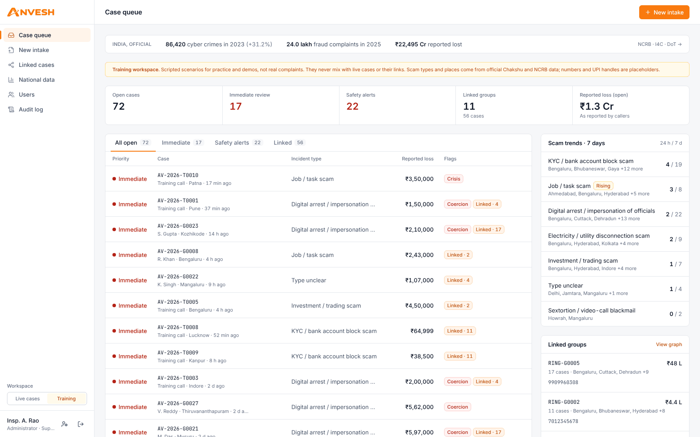
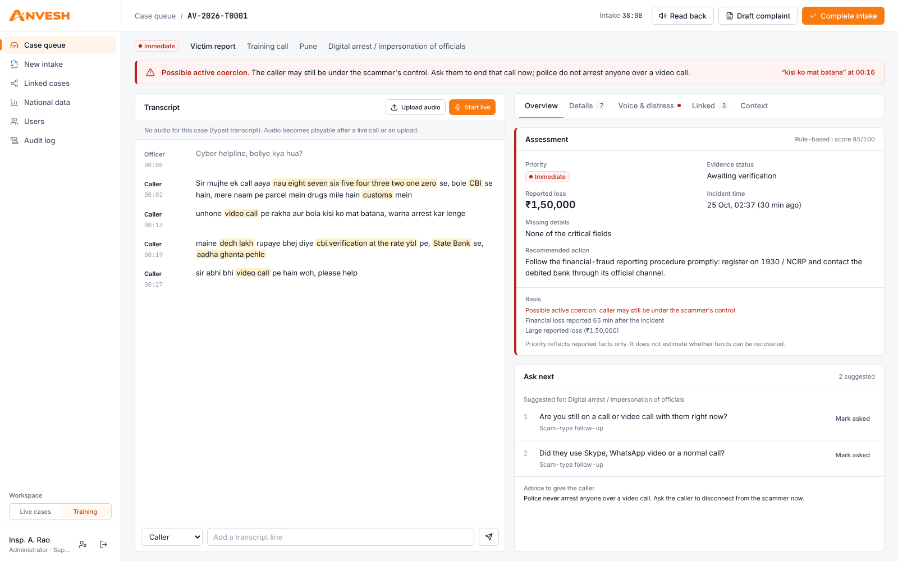
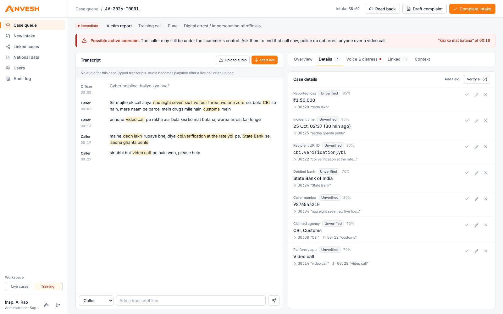
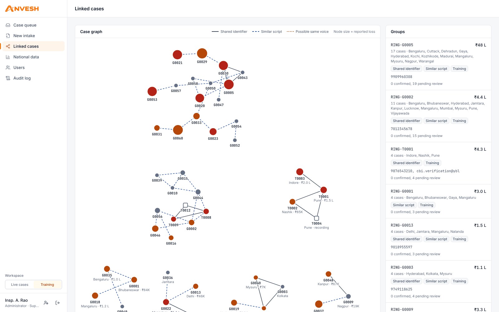
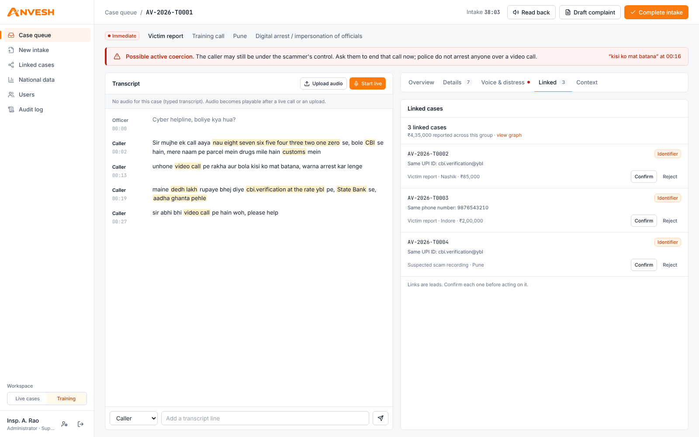
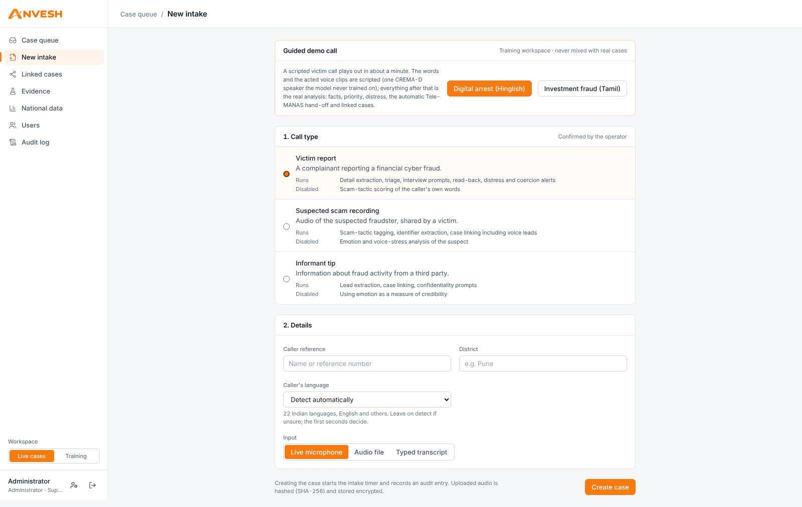
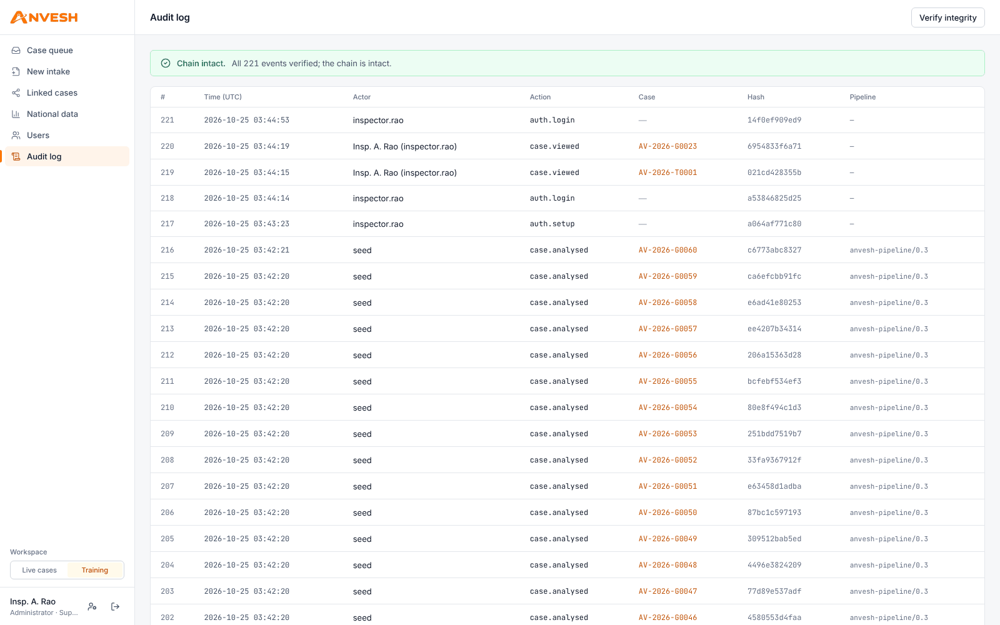
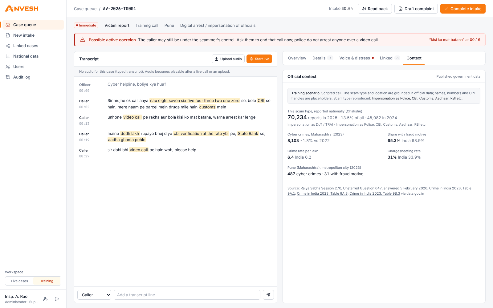
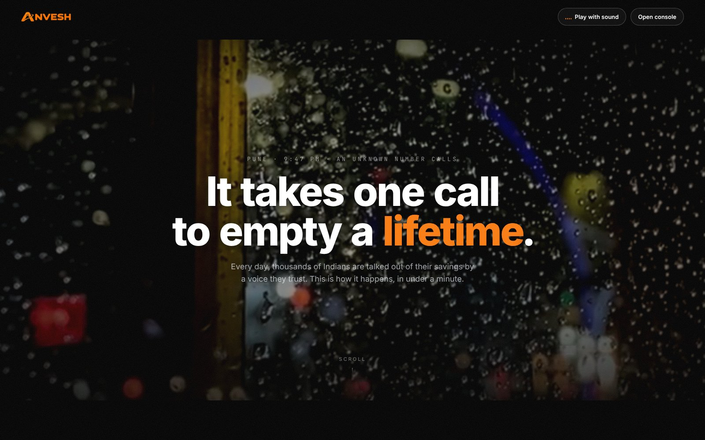
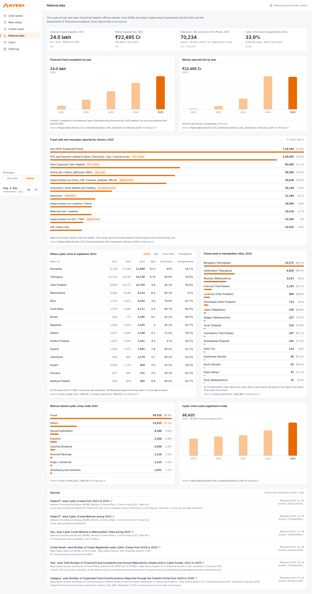

<div align="center">

# Anvesh

### Real-time speech emotion analysis for cybercrime calls, built into the investigation workflow

**Every call solves more than one case.**


*Built for the VecnaVerse National Level Hackathon · Domain: Cybersecurity ·
PS: Real-Time Speech Emotion Analysis for Cybercrime Investigation*

**Designed and developed by [Yashvi Chotalia](https://github.com/YashviChotalia)**

[Live demo](#demo) · [Demo video](#demo) · [Quick start](#quick-start) · [How it works](#how-it-works) · [Evaluation](EVALUATION.md) · [Security](SECURITY.md)

</div>

---

**Anvesh** (Sanskrit/Hindi: *search, investigation*) listens to a cybercrime call, live or recorded, and gives the
officer three things at once:

1. **Real-time emotion signals.** Fear, anger, distress and nervousness, measured against the caller's own voice and
   shown only when the signal is sustained and the audio is good enough. When unsure, it abstains.
2. **An evidence-linked case file.** Amount, time, UPI ID, bank, phone number and scam type, each linked to the exact
   second of audio it came from.
3. **Links to earlier cases.** Shared identifiers and similar scam scripts connect one call to a whole **fraud ring**.

It is built for Indian cyber cells: Hinglish speech, UPI-era fraud, and the golden hour after money leaves an
account. Emotion is always an **indicative signal for a human**, never evidence of intent, honesty or guilt.



---

## Demo

> **Live app:** *Hugging Face Space link goes here*
> **2-minute demo video:** *video link goes here*

The live app runs the full stack (speech models included) in one container on free CPU hardware, so the first live
call after a cold start can take a minute while the models load. Sign-in details for judges are in the submission
form. Every screen in this README is the real app running on the bundled training scenarios (`python -m anvesh.seed`).

---

## The problem

Cybercrime helplines take calls from distressed victims, informants and recordings of suspected fraudsters. During a
call, an officer has to judge urgency, calm the caller and write down UPI IDs, amounts and phone numbers, often while
handling other cases. Signs of fear or ongoing coercion are easy to miss, and details spoken in Hinglish
("dedh lakh", "at the rate ybl") are easy to mistype. India recorded **86,420 cyber crimes in 2023**
(NCRB, +31.2%) and **24 lakh fraud complaints in 2025** (I4C); Anvesh shows these official figures in the app,
with their sources.

## What Anvesh does

| | Typical SER demo | Anvesh |
|---|---|---|
| Output | One emotion label | Fear / anger / distress / nervousness over time, plus a case file with every detail linked to the audio |
| Accuracy safeguards | Always gives an answer | Smoothed over windows, compared with the caller's own baseline, **abstains** on poor audio or low confidence |
| Roles | Everyone treated the same | Operator-confirmed **victim / suspect recording / informant** modes; emotion scoring is **off for suspects** |
| Phone audio | Tested on studio clips only | Measured through a simulated phone line on **held-out speakers**; a telephone-adapted head lifts "needs attention" recall from **0.44 to 0.72** |
| Urgency | "Fear 0.81" | Priority from **reported facts**; sustained voice distress can raise it by **at most one level**, with the reason shown, never for suspects |
| Scope | One call | **Ring Linker** connects cases by identifier, scam script and (for suspect recordings) voice |
| Trust | Black box | Evidence for every output, officer verify/correct on every field, encrypted data, hash-chained audit log |

### Features

**Speech emotion (the core of the PS)**

- **Built and measured for phone audio.** Through a simulated phone line the stock emotion model flags only 44% of
  callers who need attention. Anvesh's telephone-adapted head, trained on other speakers' clean, phone and noisy
  audio, flags 72%, with calibrated confidence (calibration error 0.03 vs 0.44). Fully offline, under 1 ms extra.
  On whole simulated phone calls from held-out speakers it flags 75% of distressed callers (stock model: 35%), and
  no calm call ever reaches the level that can change priority.
  [Results](EVALUATION.md#3-speech-emotion-recognition)
- **Emotion helps decide who is answered first, and can never accuse anyone.** Sustained high distress on a victim
  or informant call raises the priority by one level at most; elevated distress only breaks ties. The reason is
  shown in the assessment and the officer can override it. Suspect recordings are never scored.

- **Live call mode.** Microphone audio streams over a WebSocket. Transcript, emotion and distress update every few
  seconds.
- **Four signals.** emotion2vec+ voice emotion on overlapping 3-second windows, combined with pitch, loudness and
  speaking-rate change against the caller's own baseline, mapped to **fear, anger, distress and nervousness**.
- **Built for helpline audio.** Readings are smoothed so one noisy window cannot flip them. Low-confidence windows
  show as *uncertain*. A complainant is never shown as "happy" (nervous laughter on a tense call is read as nervousness).
- **Distress track.** Sustained distress (not single spikes), role-gated, and abstains on poor audio or languages
  that have not been validated.
- **Coercion and crisis alerts.** Phrases like *"kisi ko mat batana"* or *"abhi bhi video call pe hain"* raise a
  possible-active-coercion alert. Crisis language prompts a hand-over to Tele-MANAS (14416).

**Investigation support**

- **Call → case file.** A Hinglish normaliser (*"saadhe paanch hazaar"* → ₹5,500, *"ramesh at the rate okaxis"* →
  `ramesh@okaxis`, *"aadha ghanta pehle"* → a clock time) feeds an extractor that keeps a pointer back to the exact
  words and second of audio.
- **Interview co-pilot.** Suggests the next questions from missing details and a scam-type playbook (digital arrest,
  investment, KYC, courier, sextortion, job, utility).
- **Read-back.** Reads the captured facts back to the caller in Hindi for confirmation.
- **Ring Linker.** Exact identifier matches, multilingual script similarity and voice leads on suspect recordings.
  Every link is a lead an officer confirms or rejects.
- **Synthetic-voice check.** A deepfake-audio classifier plus acoustic cues (jitter, shimmer, noise floor, rhythm)
  flag cloned or replayed audio as *likely real / needs verification / likely synthetic*, never as proof.
- **Official context.** NCRB, I4C and DoT statistics from data.gov.in, verified by SHA-256 at start-up.
- **Tamper-evident audit.** Every view, AI output and human correction goes into an HMAC-signed hash chain, with
  one-click verification.

---

## Screenshots

| Case workspace: live coercion alert and urgency assessment | Case details: every field linked to the second of audio |
|---|---|
|  |  |

| Ring Linker: shared UPI IDs, phones and scripts connect complaints into rings | Linked cases on the case page |
|---|---|
|  |  |

| New intake: role decides which analysis runs | Audit log: hash chain verified |
|---|---|
|  |  |

| Official context for each case | Landing page (`/welcome`) |
|---|---|
|  |  |

<details>
<summary>National data page (full)</summary>



</details>

---

## How it works

```
 Microphone / audio file
          │  WebSocket (live, ~5 s chunks cut at pauses)  or  upload
          ▼
 FastAPI backend ───────────────────────────────────────────────────────────────┐
 │ speech   faster-whisper ASR (Hindi/Hinglish → Roman script)                   │
 │          emotion2vec+ embedding → telephone-adapted head · caller baseline    │
 │          ECAPA speaker embeddings (suspects only) · synthetic-voice detector  │
 │ ser      3 s windows → smoothing → fear / anger / distress / nervousness      │
 │          role gating · abstention on silence, noise or low confidence         │
 │ nlp      Hinglish normaliser → extractor (with evidence) → playbooks          │
 │          coercion / crisis phrase scanner                                     │
 │ triage   transparent rules on reported facts (distress kept separate)        │
 │ linker   identifiers (blind index) · script similarity · voice leads → rings  │
 │ storage  AES-256-GCM fields · encrypted evidence · HMAC hash-chained audit    │
 └──────────────────────────────────────────────────────────────────────────────┘
          │  REST + WebSocket
          ▼
 Next.js workspace: case queue · live call · case file · Ring Linker · audit
```

- **Modular monolith.** Each module has a clear boundary; models load lazily in the background.
- **Honest about models.** `/api/health` reports exactly which models are loaded. A missing model is reported in the
  UI and the system abstains; nothing is ever simulated.
- **Runs on a laptop.** Everything runs locally on CPU. No call audio leaves the machine.

| Component | Model / library | Licence |
|---|---|---|
| Speech-to-text | faster-whisper `small` (live), `large-v3-turbo` (after the call) | MIT |
| Voice emotion | emotion2vec+ base (`iic/emotion2vec_plus_base`) + Anvesh telephone-adapted head (`anvesh/data/models/ser_head_telephone.json`, trained on CREMA-D, ODbL) | see model card |
| Speaker embeddings | SpeechBrain ECAPA-TDNN | Apache-2.0 |
| Synthetic voice | `MelodyMachine/Deepfake-audio-detection-V2` | see model card |
| App | FastAPI, SQLAlchemy, Next.js, React, Tailwind | MIT / BSD |

Full licence notes are in [LICENSES.md](LICENSES.md).

---

## Quick start

The backend runs the speech models, so it is meant to run **locally** (CPU is enough). Model weights are **not**
stored in this repository; a script downloads them once.

### Requirements

| | Minimum |
|---|---|
| OS | Windows 10/11 (one-click scripts), or Linux/macOS (manual steps) |
| Python | 3.10, 3.11 or 3.12 |
| Node.js | 18 or newer (20 LTS recommended) |
| RAM | 8 GB (16 GB recommended with all models loaded) |
| Disk | about 6 GB free for packages and model weights |
| Internet | needed once, to install packages and download models |

### Option A: Windows, one click

1. Double-click **`setup.bat`** (once). It creates the Python environment, installs everything, runs the tests,
   **downloads the speech models**, loads the training scenarios and installs the frontend.
   The first run takes 10–20 minutes, depending on your connection.
2. Double-click **`start.bat`**. It starts the backend (port 8000) and frontend (port 3000), then opens
   <http://localhost:3000>.

Logs are written to `logs\setup.log`, `logs\backend.log` and `logs\frontend.log`.

### Option B: manual setup (any OS)

**1. Backend**

```bash
cd backend
python -m venv .venv
source .venv/bin/activate              # Windows: .venv\Scripts\activate
pip install -r requirements-dev.txt    # app, tests and tools
pip install -r requirements-ml.txt     # speech models (CPU is fine)
```

**2. Download the speech models** (once, several GB)

```bash
python -m anvesh.download_models                       # all models
python -m anvesh.download_models --only asr emotion    # or just some of them
```

Each model is reported as `ok` or `FAIL`. If a model fails, the app still runs: that signal is shown as unavailable
and the system abstains. Models that are missing are also downloaded in the background when the backend starts.

**3. Load the training scenarios and start the API**

```bash
python -m anvesh.seed --reset          # 72 labelled training scenarios (use --none for an empty database)
uvicorn anvesh.api:app --port 8000
```

**4. Frontend** (in a second terminal)

```bash
cd frontend
cp .env.example .env.local             # Windows: copy .env.example .env.local
npm install
npm run dev                            # http://localhost:3000
```

### First sign-in

1. Open <http://localhost:3000> **on the same computer** that runs the backend.
2. On first run you are asked to create the administrator account (name, username, password of 12+ characters).
   For security, this is only allowed from the server computer.
3. You are signed in as administrator and supervisor. Add officers later under **Users**.

### Try it in two minutes

1. Open the **Training** workspace (bottom left) and click **AV-2026-T0001**. You'll see the coercion alert, the
   urgency assessment, and under **Details** each field with a ▶ link to the moment it was said.
2. Open the **Linked** tab, then **Linked cases** in the sidebar, to see the fraud ring.
3. Click **New intake** → *Victim report* → *Live microphone* → **Create case**, then **Start live** and speak in
   Hindi, English or Hinglish. The transcript, the four emotion signals and the case details fill in as you talk.
4. The sidebar's **System** panel shows which models are loaded.

### Other ways to run

- **Docker** (backend, frontend and PostgreSQL):
  `ANVESH_DATA_KEY=$(python -c "from cryptography.fernet import Fernet;print(Fernet.generate_key().decode())") docker compose up --build`
- **Hosted demo (Hugging Face Space, free):** `deploy_space.bat --space <hf-user>/anvesh --admin judge.admin`
  (or `python scripts/deploy_space.py ...`). It builds one container from `deploy/huggingface/`: nginx on port 7860
  in front of the Next.js app and the API, so the app, API and live-call WebSocket share one origin and the
  `SameSite=Strict` session cookie keeps working. The administrator is created from Space secrets, because first-run
  setup is refused for anyone not on the server itself. Open the app at `https://<hf-user>-anvesh.hf.space`.
- **Frontend only on Vercel:** import the repository, set *Root Directory* to `frontend` and set
  `NEXT_PUBLIC_API_URL` to the backend address. The landing page `/welcome` needs no backend; sign-in needs the API
  on the same site (the session cookie is `SameSite=Strict`), so use the Space above for a full hosted demo.

### Configuration

All settings are optional environment variables.

| Variable | Default | Meaning |
|---|---|---|
| `ANVESH_ASR_MODEL` | `small` | live speech-to-text size (`base` for low-RAM laptops) |
| `ANVESH_ASR_FINAL_MODEL` | `large-v3-turbo` | accurate re-transcription after a call |
| `ANVESH_EMOTION_MODEL` | `iic/emotion2vec_plus_base` | voice emotion checkpoint |
| `ANVESH_SPOOF_MODEL` | `MelodyMachine/Deepfake-audio-detection-V2` | synthetic-voice detector |
| `ANVESH_ENABLE_ASR_FINAL` / `_EMOTION` / `_SPEAKER` / `_SPOOF` | `1` | turn individual models off (`0`) |
| `ANVESH_TEXT_EMBEDDER` | *(empty)* | e.g. `paraphrase-multilingual-MiniLM-L12-v2` for cross-language script links |
| `ANVESH_VALIDATED_LANGS` | `en,hi` | languages where the voice distress track may score |
| `ANVESH_SER_HEAD` | `auto` | telephone-adapted emotion head: `auto` (use it when present), `off` (raw emotion2vec+), or a path to another head file |
| `ANVESH_MASTER_KEY` | generated in `~/.anvesh/keys` | 32-byte base64 master key (use a secret manager in production) |
| `ANVESH_SESSION_IDLE_MIN` / `ANVESH_SESSION_MAX_HOURS` | `30` / `12` | session idle timeout and maximum lifetime |
| `ANVESH_RETENTION_DAYS` | `0` (keep) | erase closed cases older than this at start-up |
| `ANVESH_MAX_UPLOAD_MB` | `100` | largest audio upload accepted |
| `ANVESH_BOOTSTRAP_ADMIN` / `ANVESH_BOOTSTRAP_PASSWORD` | *(empty)* | hosted deployments: create the first administrator at start-up when no account exists (password change forced at first sign-in) |
| `NEXT_PUBLIC_API_URL` (frontend, build time) | `http://localhost:8000` | API address; empty = same origin as the app |

### Troubleshooting

| Problem | Fix |
|---|---|
| A model shows *Error* in the System panel | Run `python -m anvesh.download_models` and check the output; see `logs\backend.log` |
| Slow transcription on an older laptop | Set `ANVESH_ASR_MODEL=base` and `ANVESH_ENABLE_ASR_FINAL=0` |
| Setup page says it is only allowed from the server | Open the app on the same computer as the backend, at `localhost` |
| Port 8000 or 3000 already in use | `start.bat` frees them; otherwise stop the other program |
| Encrypted data cannot be read after moving machines | Copy `~/.anvesh/keys/master.key` with the data (back it up separately) |

---

## Testing and evaluation

```bash
cd backend
pytest -q                                   # 117 unit and API tests (no models needed)
python eval/run_eval.py                     # Hinglish field extraction: 38/38 on the development set
python eval/get_eval_audio.py --crema-all   # CREMA-D clips + speaker demographics (once, ~500 MB)
python eval/run_ser_eval.py --crema-d eval/audio/crema-d --holdout --limit 800   # studio, phone line, noise
python eval/run_call_eval.py --crema-d eval/audio/crema-d   # whole simulated phone calls (distress track)
python eval/run_ser_eval.py --from-cache    # re-derive every table from saved predictions (no model needed)
python eval/train_ser_head.py --crema-d eval/audio/crema-d   # rebuild the telephone-adapted head (optional)
python eval/run_ser_eval.py --manifest own_samples.csv   # your own / role-play / YouTube clips
cd ../frontend && npm run typecheck && npm run build
```

CI runs the tests, the extraction evaluation, linting, security scans and the frontend build on every push.
The methodology, results and limitations are in **[EVALUATION.md](EVALUATION.md)**.

---

## Responsible use

- Outputs are **indicative signals for human review**, never evidence of honesty, intent or guilt.
- Emotion and voice-stress scoring are **disabled for suspects** by design. Voice-similarity links are leads only.
- Financial priority comes from reported facts with transparent rules and does **not** predict recoverability.
  Voice distress can raise a call by **one level at most**, only when it is sustained, with the reason shown.
- Emotion accuracy is **measured, not assumed**: on phone-line audio, per speaker group, with calibration, on
  speakers never used in training ([EVALUATION.md](EVALUATION.md#3-speech-emotion-recognition)).
- The system **abstains** when audio is poor, the model is unsure or the language has not been validated.
- Every AI output can be verified or corrected by the officer, and every correction is logged.
- **Official data, not invented numbers.** `backend/anvesh/data/official/` holds byte-identical copies of six
  data.gov.in files (NCRB *Crime in India 2023* tables 9A.1, 9A.3, 9B.3; Rajya Sabha answers with I4C and DoT
  Chakshu data). The app refuses to show them if a hash or published total does not match.
- **Calls are training scenarios.** No government body publishes victim calls, so the bundled transcripts are
  scripted, labelled *Training scenario* in the UI, and use placeholder numbers and UPI handles.
- No call audio is used for training. See [LICENSES.md](LICENSES.md) before any commercial use.

## Security

Anvesh handles some of the most sensitive data a police unit holds, so it has:

- **Accounts and roles.** Named accounts with roles (operator, supervisor, administrator), scrypt password hashes,
  account lockout and 30-minute idle sessions.
- **Encryption.** Field-level AES-256-GCM encryption of personal data, and keyed blind indexes for linking
  identifiers.
- **Audit.** An HMAC-signed audit chain that contains no personal data.
- **Tests.** Every route and role is covered by `backend/tests/test_security.py`.

See [SECURITY.md](SECURITY.md) for the threat model and controls.
**Back up `~/.anvesh/keys/master.key` separately: without it the encrypted cases cannot be read.**

## Roadmap

Telephony integration for live 1930 calls · NCRP-format export · speaker diarization · emotion model fine-tuned on
commercially licensed Indian-language data · per-language validation · campaign radar for new scam scripts ·
multi-tenant deployment and DPDP Act compliance mapping.

## Project structure

```
backend/
  anvesh/          API, speech models, live SER, NLP, triage, linker, audit, storage
  anvesh/data/     official NCRB / I4C / DoT data with sources.json
  eval/            extraction and speech-emotion evaluation scripts
  tests/           117 unit, API and security tests
frontend/          Next.js workspace and landing page
scripts/           Windows setup and start scripts
docs/screenshots/  images used in this README
```

## Author

**Yashvi Chotalia**: design, development and research.
Landing-page footage is from Pexels (free licence); the people shown are actors. Official statistics are credited in
`backend/anvesh/data/official/sources.json`.
